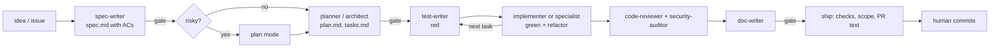

# Architecture

## Layers

1. **This marketplace**: generic, versioned plugins. `subdd-core` is the pipeline,
   `subdd-<stack>` packs carry language conventions, `subdd-dev`, `subdd-product` and
   `subdd-aiops` add specialists.
2. **Personal layer (optional)**: the user's own `~/.claude/CLAUDE.md`, `~/.claude/agents/` and
   `~/.claude/skills/`, which apply to every project without a separate marketplace.
3. **Project factory**: each project's `CLAUDE.md`, `.claude/settings.json`, and
   `.claude/skills|agents` with domain knowledge and project workflows, generated with
   `/subdd-aiops:new-factory`.
4. **Artifacts**: `docs/specs/NN-<slug>/{spec,plan,tasks}.md`, `docs/research/`, `evals/`.
   Agents hand off through files, so work survives context resets and is reviewable in PRs.

## Choosing the right primitive

| Need | Primitive |
|---|---|
| Always true for a project | `CLAUDE.md` |
| Must be enforced, no exceptions | Hook |
| Knowledge Claude should apply when relevant | Skill |
| A process you trigger by name | Workflow skill (`disable-model-invocation: true`) |
| Isolated specialist (own context, tools, model) | Agent |
| Access to an external system | MCP server |

Prefer a skill over a new agent. Create an agent when it needs restricted tools, a different
model, or a long specialised prompt that would pollute the main context.

## The core pipeline

## Execution modes

The same workflows run two ways. **Inline**: the main session implements with the skills
loaded; cheapest, keeps context, best for small plans. **Agents**: named subagents with clean
contexts, their own tools and model; costs more tokens (each one starts cold and re-reads what
it needs) and pays off for larger plans, cross-area work and parallel tasks. The cost comes
from how many subagents a run launches, not from how many agents are defined. `--auto` is
orthogonal: it only changes who commits and opens the PR.

## Stack packs and preloading

Agents preload skills through the `skills:` frontmatter. A bare name refers to the agent's own
plugin; `plugin:skill` refers to another plugin. When that plugin is not installed, the agent
still loads without the skill. That is how core agents stay language-agnostic: they list the
pack skills (`subdd-typescript:typescript-style`) and get them only where the pack is enabled.

## Model policy

- **opus**: judgement: architecture, specs, plans, tests, review, debugging, security, data
  and API design, UX, product, agent design, prompts, evals.
- **inherit**: builders (implementer, frontend, backend, DevOps, QA, performance, refactorer,
  copywriter, skill author), so the session model decides.
- **sonnet**: research and high-volume work (market research, SEO, data analysis, docs).

## Hooks

- `guard-protected-files.sh` (always on): blocks edits to `.env*` (except examples), keys and
  credentials, and lockfiles unless `SUBDD_ALLOW_LOCKFILE_EDITS=1`. Extra patterns via
  `SUBDD_PROTECTED_EXTRA`.
- `guard-git-writes.sh` (opt-in with `SUBDD_BLOCK_GIT_WRITES=1`): blocks commit, push, merge,
  rebase, tag, hard reset and `gh pr create|merge`.

## Naming and versioning

- Plugins `subdd-<area>`; agents are role nouns; knowledge skills are topic nouns; workflows are
  verbs or short commands.
- Each plugin has its own semver. Renamed agents or workflows, or changed artifact paths, bump
  the major version and go in CHANGELOG.md.
