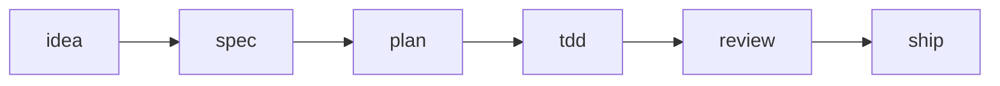

# AI factory blueprint: <project>

## Project summary
Domain, users, stack, architecture, repo layout, test and deploy setup.

## Goals for the factory
What should get faster or more reliable (e.g. shipping features test-first, reviews, content production, data analysis).

## Plugins to enable
| Plugin | Why |
|---|---|
| subdd-core | |
| subdd-typescript (or another stack pack) | |
| subdd-dev | |
| subdd-product | |
| subdd-aiops | |

## Project-specific components
| Type | Name | Purpose | Model / tools | Location |
|---|---|---|---|---|
| skill | <project>-domain | Domain glossary, business rules | - | .claude/skills/ |
| skill | <project>-conventions | Stack and code conventions | - | .claude/skills/ |
| workflow | | | | .claude/skills/ |
| agent | | | | .claude/agents/ |
| hook | | | | .claude/settings.json |
| MCP | | | | .mcp.json |

## Flow

## Gates
Where a human approves.

## Rollout
1. Generate files. 2. Try on one real task. 3. Adjust prompts. 4. Promote reusable pieces to subdd.
